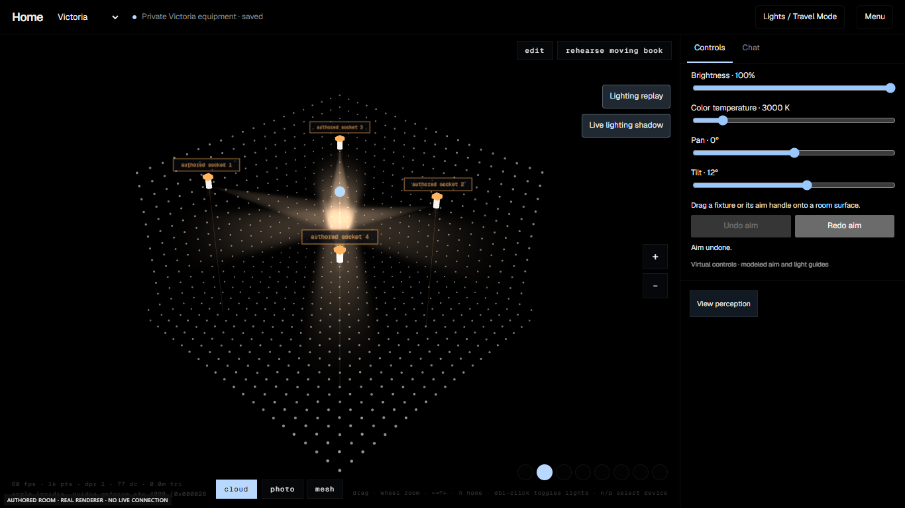
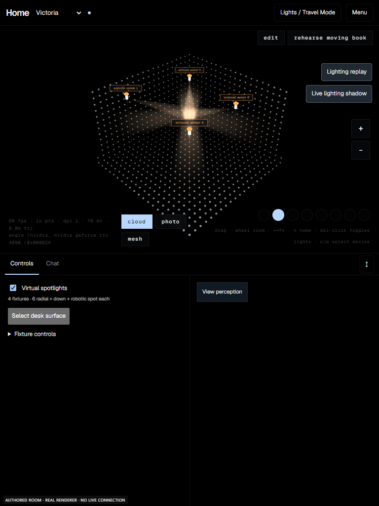
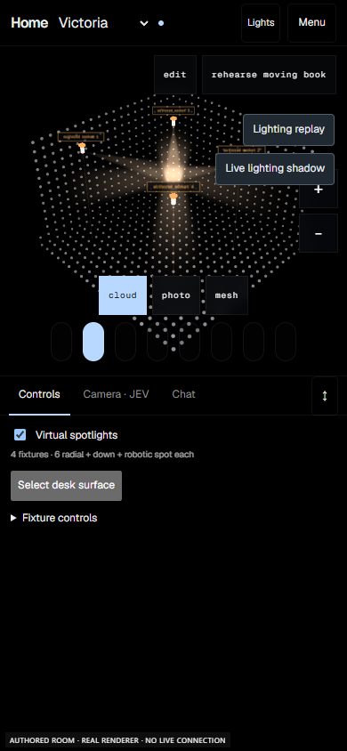
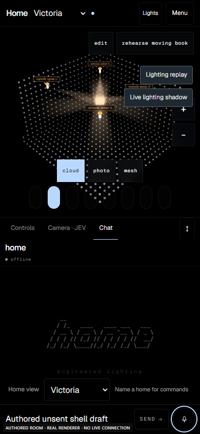
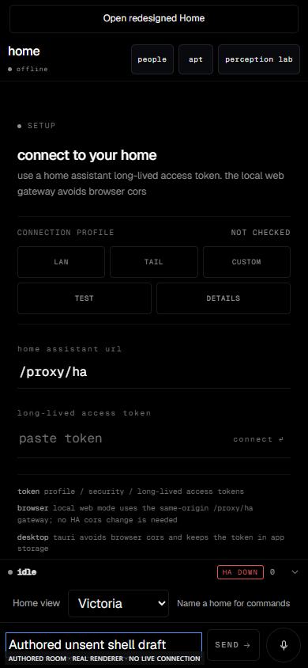

# Phase 1 browser evidence

These screenshots show **authored room data and generated sockets on Home's production renderer**. They contain no private scan, camera imagery or live inference. The browser harness blocks external connections, acquisition and physical output.

| View | Screenshot |
|---|---|
| Desktop fixture controls |  |
| Tablet controls and camera dock |  |
| Phone controls |  |
| Phone Chat |  |
| Previous Home |  |

`verification.json` records source pins, tested scenarios, passing suites and known baseline failures. This is local software verification, not deployment or physical acceptance.
